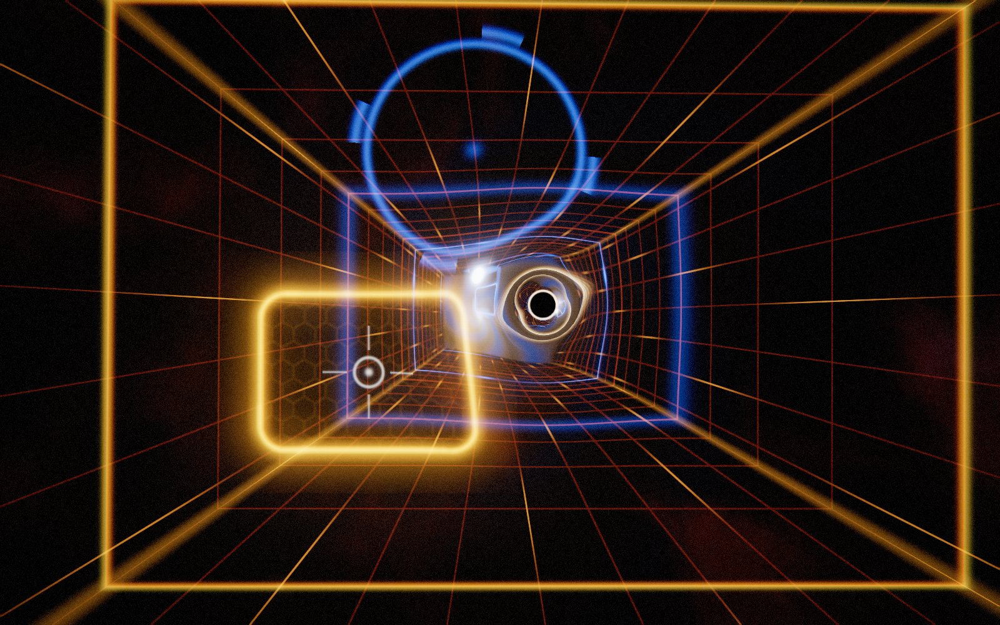
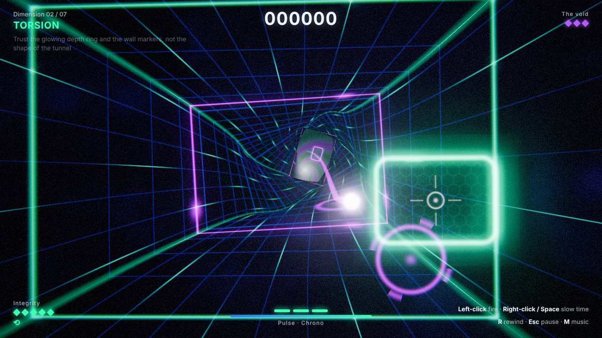
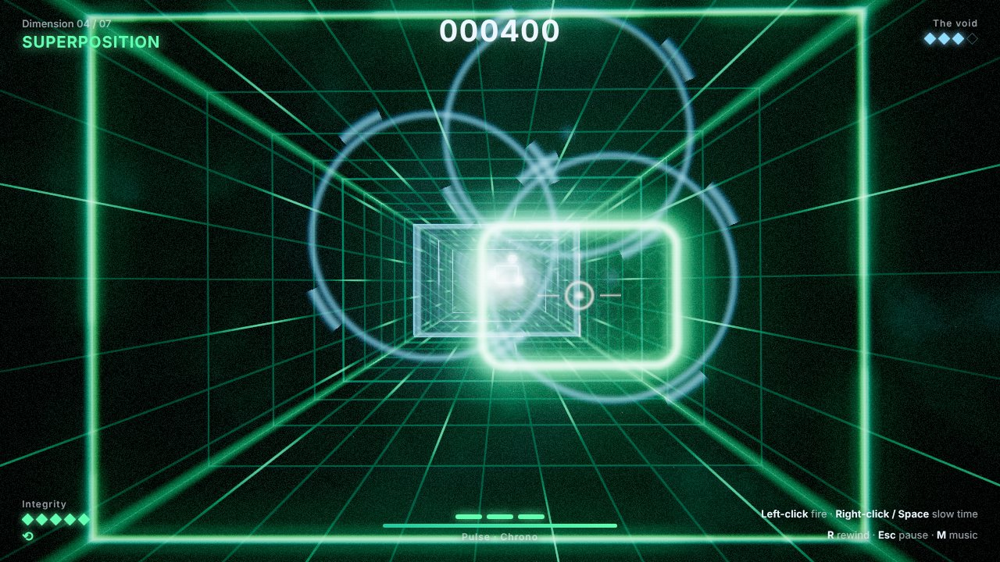
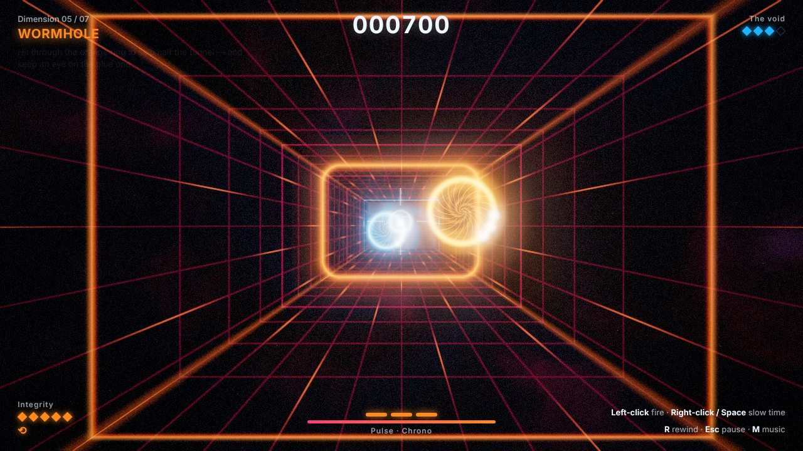
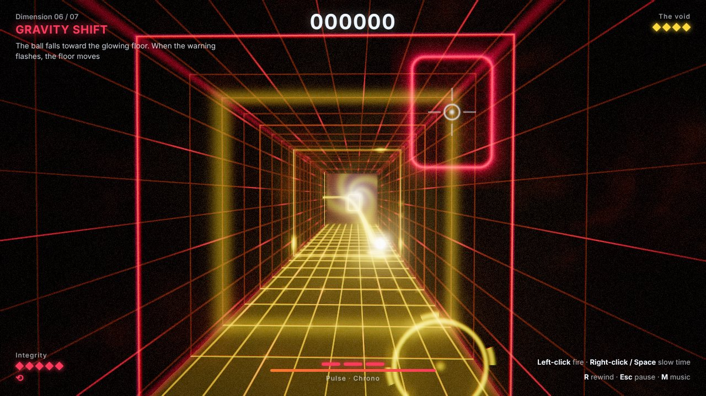
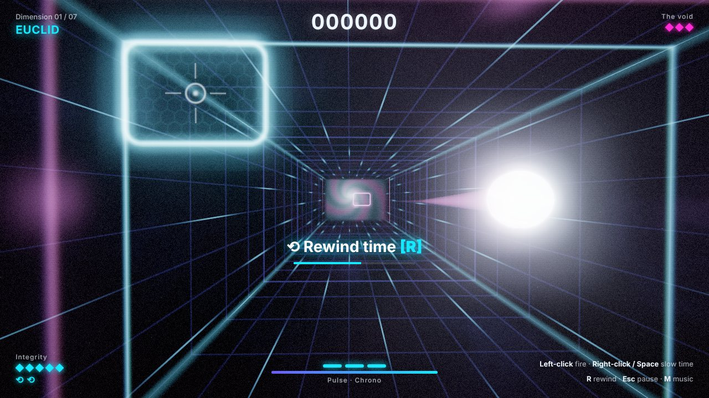
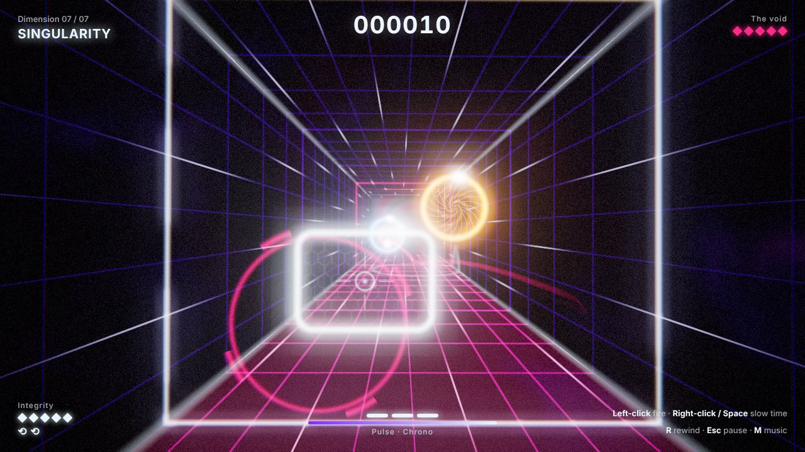
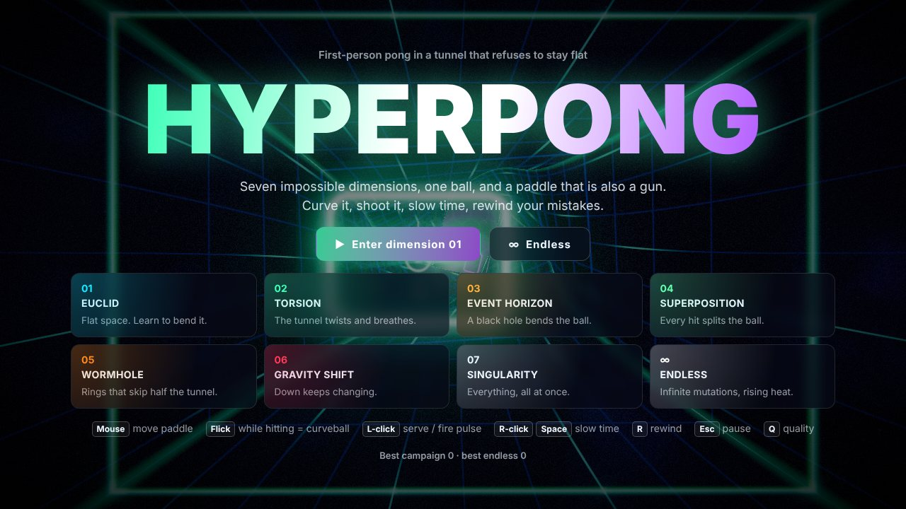
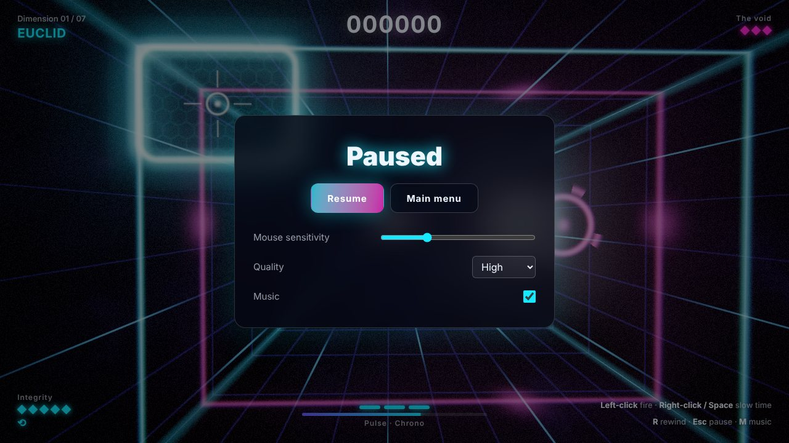

# HYPERPONG

Düz kalmayı reddeden neon bir tünelde birinci şahıs 3B pong: topu falsoyla kıvır, uçarken vur, zamanı yavaşlat, kaçırdığın topu geri sar. Yedi imkânsız boyut, tek bir HTML dosyası.
First-person 3D pong in a neon tunnel that refuses to stay flat: curve the ball, shoot it mid-flight, slow time, rewind your misses. Seven impossible dimensions in a single HTML file.

**Canlı sürüm / Live:** https://erenciracioglu-dotcom.github.io/hyperpong/



[Türkçe](#türkçe) · [English](#english)

## Türkçe

Neon bir tünelin bir ucunda, parlayan kendi raketinin arkasındasın; öbür uçta boşluğun raketi bekliyor. Kural eski pong kuralı: top arkandan geçerse sayı gider. Ama raketin aynı zamanda bir silah, zaman senin elinde ve her boyut uzayın başka bir kuralını bozuyor.

### Nasıl oynanır

| Girdi | Ne yapar |
|---|---|
| Fare | Raketi oynatır; nişangâh raketin ortasındadır |
| Vururken fareyi savur | Topa falso verir, top kıvrılarak gider |
| Sol tık | Servis at, sonra darbe ateşle |
| Sağ tık · Boşluk · Shift (basılı tut) | Zamanı yavaşlat (Krono çubuğu azalır) |
| R | Zamanı geri sar (her boyutta sınırlı hak) |
| Esc · P | Duraklat: fare hassasiyeti, kalite, müzik |
| M | Müziği aç/kapat |
| Q | Görüntü kalitesi |

Dokunmatik ekranda parmağını sürükleyerek raketi oynatır, dokunarak servis atar ve ateş edersin; FIRE, SLOW ve ⟲ düğmeleri ekranda çıkar.

- **Falso:** Vuruş anında fareyi hangi yöne savurursan top o yöne kıvrılır; raketin kenarıyla vurursan açı alır. Atışın ne kadar iyiyse boşluğun okuması o kadar şaşar.
- **Darbe tabancası:** Sol tık, nişangâhın gösterdiği yere bir enerji darbesi yollar. Topa değerse onu havada iter; boşluğun raketine değerse yarım saniye dondurur, ardından raket birkaç saniyelik bir kalkan açar. Üç şarj, kendiliğinden dolar.
- **Mermi zamanı:** Sağ tık ya da Boşluk dünyayı üçte bir hıza indirir; sen normal hızda kalırsın.
- **Geri sarma:** Topu kaçırınca zaman neredeyse durur ve bir saniyeliğine "R" belirir. Basarsan son 2,5 saniye VHS kaseti gibi geri sarılır.
- **Zincirler:** Sayıyı hangi numarayla aldığın puanı büyütür: falso, yön değiştirme, sersemletme, solucan deliği, sapan, gözlemci etkisi. Birden çok numara zincir çarpanı verir.

### Yedi boyut

| # | Boyut | Ne bozuluyor |
|---|---|---|
| 01 | EUCLID | Düz uzay. Falsoyu burada öğren. |
| 02 | TORSION | Tünel bükülür, nefes alır, eğilir. Fizik dümdüz kalır, gözlerin kalmaz. |
| 03 | EVENT HORIZON | Gezinen bir kara delik topu çeker ve çevresindeki ışığı büker. Topu yakından geçir, sapan gibi fırlasın. |
| 04 | SUPERPOSITION | Her vuruş topu üç olasılık hayaletine böler; hangisinin gerçek olduğuna tünelin ortasındaki zar karar verir. Zara varmadan birini vurursan gerçek olan o olur. |
| 05 | WORMHOLE | Turuncu halka senden uzaklaşan topu yutar, maviden çıkarır; mavi de sana gelen topa aynısını yapar. |
| 06 | GRAVITY SHIFT | Yerçekimi birkaç saniyede bir 90° döner ve bütün dünya onunla birlikte yuvarlanır. |
| 07 | SINGULARITY | Her sayıda iki kural birden değişir; boşluk, kontrollerini ters çeviren kırmızı bozulma mermileri atar. Vur ya da kaç. |
| ∞ | ENDLESS | Sonsuz mutasyon. Boşluğun canı bitmez, seninki biter; her sayıda rakip keskinleşir. |

Kampanyada her boyutu geçince bir can geri kazanırsın. Ana menüden istediğin boyuttan başlayabilirsin; menünün arkasında iki yapay zekâ birbirine karşı oynar.

### Nasıl çalışıyor

Fizik dümdüz bir kutu tünelde döner. Bükülme, eğilme ve nefes alma görüntüde bir uzay bükmesiyle (vertex shader) yapılır ve senin raketinin düzleminde hiçbir şeyi değiştirmez: kontrolün hep dürüst kalır, tünelin uzak ucu ise yalan söyleyebilir. Darbeler görüntü uzayında ilerler; ekranda neye nişan alırsan ona çarparsın. Kara delik topa gerçek bir ters kare çekimi uygular, ışığın bükülmesi ise kütleçekimsel mercek efektiyle çizilir. Geri sarma için saniyede 60 anlık görüntü tutulur. Bütün sesler Web Audio ile anında sentezlenir; synthwave müziğin temposu mermi zamanında yavaşlar. Kare hızı düşerse çözünürlük kendiliğinden azalır (Q ile elle seçebilirsin).

### Çalıştırma

Tek bir HTML dosyası; kurulum ya da sunucu gerekmez. `index.html` dosyasını güncel bir Chrome ya da Edge'de açmak yeterli (three.js dosyanın içinde). WebGL2 ve donanım hızlandırma gerekir. Sesi aç.

Kodu değiştirmek için `src/` içindeki dosyaları düzenle, sonra:

```
npm install
npm run build   # index.html'i src/ klasöründen yeniden üretir
npm run check   # fizik ve yapay zekâ için başsız kısa test
```

### Hakkında

HYPERPONG, Claude'un (Anthropic) Eren için tek bir oturumda yaptığı bir oyun; Kasım 2026. Tasarım ve kod Claude'a ait.

## English

You stand behind your own glowing paddle at one end of a neon tunnel; the void's paddle waits at the other. The rule is the old pong rule: if the ball gets past you, you lose the point. But your paddle is also a gun, time is in your hands, and every dimension breaks a different rule of space.

### How to play

| Input | Action |
|---|---|
| Mouse | Move the paddle; the crosshair sits at its centre |
| Flick the mouse as you hit | Put spin on the ball so it curves |
| Left click | Serve, then fire a pulse |
| Right click · Space · Shift (hold) | Slow time (drains the Chrono bar) |
| R | Rewind time (a limited number per dimension) |
| Esc · P | Pause: mouse sensitivity, quality, music |
| M | Music on/off |
| Q | Graphics quality |

On a touch screen, drag to move the paddle and tap to serve and fire; FIRE, SLOW and ⟲ buttons appear on screen.

- **Curveballs:** flick the mouse as you hit and the ball curves that way; hit it with the edge of the paddle for an angle. The better your shot, the shakier the void's read on it.
- **Pulse gun:** left click sends an energy pulse to wherever the crosshair points. It shoves the ball mid-flight, and a hit on the void's paddle freezes it for half a second before it puts up a shield for a few seconds. Three charges that refill on their own.
- **Bullet time:** right click or Space drops the world to a third of its speed while you keep moving at full speed.
- **Rewind:** when you miss, time almost stops and "R" appears for about a second. Press it and the last 2.5 seconds rewind like a VHS tape.
- **Chains:** the trick that wins a point multiplies its score: curve, redirect, stun, wormhole, slingshot, observer effect. Stack several for a chain multiplier.

### Seven dimensions

| # | Dimension | What breaks |
|---|---|---|
| 01 | EUCLID | Flat space. Learn to curve here. |
| 02 | TORSION | The tunnel twists, breathes and bends. The physics stays perfectly straight; your eyes will not. |
| 03 | EVENT HORIZON | A wandering black hole drags the ball and bends the light around it. Thread the ball close for a gravity slingshot. |
| 04 | SUPERPOSITION | Every hit splits the ball into three probability ghosts; a membrane in the middle of the tunnel decides which one is real. Shoot one before it gets there and that one becomes real. |
| 05 | WORMHOLE | The orange ring swallows balls flying away from you and spits them out of the blue one; blue does the same to balls flying at you. |
| 06 | GRAVITY SHIFT | Gravity turns 90° every few seconds and the whole world rolls with it. |
| 07 | SINGULARITY | Two rules change every point, and the void fires red glitch bolts that invert your controls. Shoot them down or dodge. |
| ∞ | ENDLESS | Endless mutations. The void never runs out of lives; you do. It sharpens every time you score. |

Clearing a dimension in the campaign gives you a life back. You can start from any dimension on the main menu, where two AIs play each other in the background.

### How it works

The physics runs in a straight box tunnel. The twisting, bending and breathing are a space warp applied in the vertex shader that leaves your paddle's plane untouched: your control stays honest while the far end of the tunnel is free to lie. Pulses travel in visual space, so what you aim at on screen is what you hit. The black hole pulls the ball with real inverse-square gravity, and its light bending is drawn as a gravitational-lensing effect. Rewind keeps 60 snapshots a second. Every sound is synthesized live with Web Audio, and the synthwave soundtrack slows down in bullet time. If the frame rate drops, the resolution steps down by itself (Q picks it manually).

### Running it

One HTML file, with no install and no server. Open `index.html` in a current Chrome or Edge (three.js is bundled inside). It needs WebGL2 with hardware acceleration turned on. Turn the sound up.

To change the code, edit the files in `src/`, then:

```
npm install
npm run build   # regenerates index.html from src/
npm run check   # quick headless test of the physics and the AI
```

### About

HYPERPONG was made by Claude (Anthropic) for Eren in a single session; November 2026. The design and the code are Claude's.

## Ekran görüntüleri / Screenshots

| | |
|---|---|
|  |  |
|  |  |
|  |  |
|  |  |

## Lisans / License

MIT. [LICENSE](LICENSE) dosyasına bakın; three.js de MIT lisanslıdır, bkz. [THIRD_PARTY_NOTICES.md](THIRD_PARTY_NOTICES.md).
MIT. See [LICENSE](LICENSE); three.js is MIT-licensed too, see [THIRD_PARTY_NOTICES.md](THIRD_PARTY_NOTICES.md).
